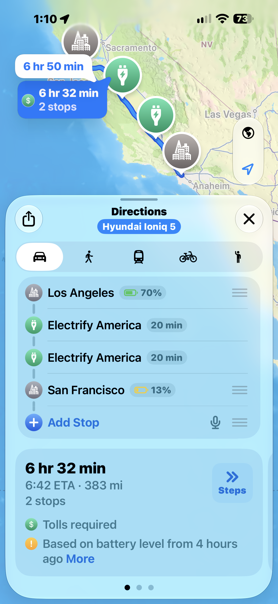

# E-GMP CarPlay EV Routing

Adds EV routing to Apple Maps through CarPlay on supported Hyundai Ioniq 5, Hyundai Ioniq 6 and Kia EV6 Gen5W head units. Apple Maps can show estimated battery levels and include charging stops when planning a route.

**Current release: v0.5.3 (experimental)**

This is an experimental, unofficial modification. It changes software on the infotainment system and is not affiliated with Hyundai, Kia or Apple.

## Supported vehicles

| Vehicle | Head-unit model | Battery profiles included |
|---|---|---|
| Hyundai Ioniq 5 | `NEEV` or `NEEV23` | 58, 72.6, 77.4 and 84 kWh |
| Hyundai Ioniq 6 | `CEEV` | 53 and 77.4 kWh |
| Kia EV6 | `CVEV` | 58, 77.4 and 84 kWh |

Installation is selected by vehicle model, without a region or firmware allowlist. At startup, the head unit must still pass HMG-API's car-map checks and the mod's native-library compatibility check; an unknown build may install but remain inactive. The Korean EV6 (260902) is one: its HMG-API map lacks required iAP2 points ([Compatibility](docs/COMPATIBILITY.md)).

The Ioniq 5 integration has been tested on US firmware 260507. Other configurations remain experimental. EV6 and Ioniq 6 energy models need further validation; inaccurate values affect Apple Maps estimates, not the car's battery controls.

See [Compatibility](docs/COMPATIBILITY.md) for the complete technical requirements and current validation status.

## Before installing

You need:

- [NEMESIS](https://github.com/xwtk/hmg_nemesis)
- [HMG-API 1.1.0-rc.3 or newer](https://github.com/Open-HMG/HMG-API/releases)
- HMG-API's [Wireless CarPlay + Android Auto](https://github.com/Open-HMG/hmgapi-wireless-cp-aa/releases) mod 2.2.0-rc.4 or newer, installed and working
- A supported Ioniq 5, Ioniq 6 or EV6 with a compatible HMG-API car map

Confirm that ordinary CarPlay works before installing EV Routing.

## Install

1. Download `egmp-carplay-ev-routing-v0.5.3.zip` from the v0.5.3 release.
2. Copy the ZIP unchanged into `HMGAPI/updates/` on a USB stick. Do not unzip it.
3. In HMG-API, select **Check USB updates**, install and enable E-GMP CarPlay EV Routing, then select **Apply changes**.
4. Remove the USB stick and fully reboot the head unit.
5. Delete the existing car pairing from both the head unit and the iPhone, then pair again and allow CarPlay.
6. On the iPhone, open Apple Maps, tap your profile picture, select **Vehicles**, and add or select the detected vehicle.

The iPhone re-pairing step is required; reconnecting the old pairing is not enough.

See the [illustrated installation guide](docs/INSTALLATION.md) for detailed steps, updating, removal and troubleshooting.

## Using EV routing

After adding the vehicle in Apple Maps, select it when planning driving directions. Maps can then estimate battery levels and add charging stops where needed.

The mod automatically selects the vehicle and battery profile. If the BMS-reported capacity selects the wrong profile, open this mod's settings in HMG-API and choose a manual battery capacity. Leave it on **Automatic (BMS)** unless needed. The 53 kWh override is for Ioniq 6 only; 72.6 kWh is for Ioniq 5 only. After changing the setting, apply changes and fully reboot.

## Important limitations

- This release is experimental and has not been validated on every region, firmware, battery or trim.
- Arrival estimates and charging stops depend on experimental energy models and may be inaccurate.
- The 77.4 kWh profiles are the reference models. Other capacities are scaled from them and have not been independently calibrated, so their estimates are more likely to be inaccurate.
- EV6 and Ioniq 6 calibration needs additional real-world validation.
- Installation compatibility does not guarantee accurate routing for a particular vehicle.

If installation or startup is refused, do not bypass the compatibility checks. Export the logs and see [Logging and diagnostics](docs/LOGGING.md).

## Documentation

- [Installation and removal](docs/INSTALLATION.md)
- [Compatibility](docs/COMPATIBILITY.md)
- [Vehicle and battery profiles](docs/PROFILE.md)
- [Logging and diagnostics](docs/LOGGING.md)
- [Validation and known limits](docs/VALIDATION.md)
- [Building from source](docs/BUILDING.md)

## Credits and license

Special credit to [augard/evmaps](https://github.com/augard/evmaps) for charging and consumption reference material. Built on [HMG-API](https://github.com/Open-HMG/HMG-API) and NEMESIS, with vehicle-data research from [egmp-aa-ev-feat](https://github.com/willemcvu/egmp-aa-ev-feat).

Licensed under GPL-3.0-or-later; see [LICENSE](LICENSE) and [NOTICE](NOTICE.md). No Hyundai, Kia, Apple or Google binaries are distributed.
